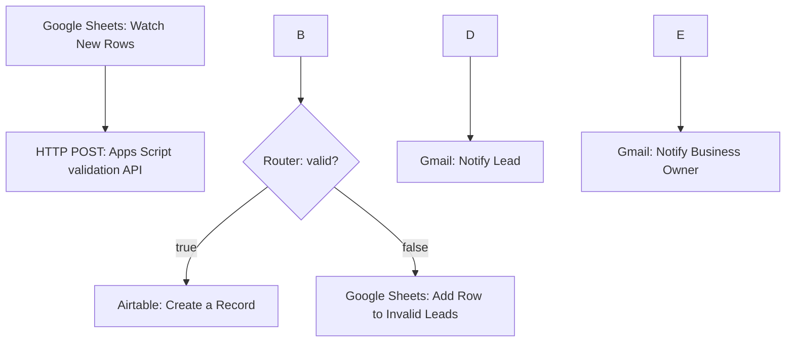

Lead Capture → CRM → Automated Follow-Up & Notification
A portfolio project demonstrating a Make.com lead-capture workflow with external JavaScript validation using Google Apps Script.
> \*\*Project type:\*\* Personal portfolio / demonstration project  
> \*\*Important:\*\* This repository documents a Make.com scenario and a Google Apps Script validation endpoint. It is not evidence of employment or a client production deployment. Replace example values and screenshots with your own verified implementation details before presenting it as complete.
Project overview
The workflow watches a Google Sheets lead-capture sheet for new rows, sends each lead to a Google Apps Script web app over HTTP, and uses the validation result to route the record:
Valid lead (`valid: true`) → create a record in Airtable → send an acknowledgement email to the lead → notify the business owner.
Invalid lead (`valid: false`) → add a row to a separate Google Sheets `Invalid Leads` tab for review.
The Apps Script validates four fields: `name`, `email`, `phone`, and `message`.
Workflow architecture

Technology stack
Make.com — workflow orchestration, scheduling, routing and module execution history
Google Sheets — lead intake and invalid-lead log
Google Apps Script — JavaScript validation endpoint deployed as a web app
HTTP / JSON — request and response between Make.com and Apps Script
Airtable — CRM record storage
Gmail — lead acknowledgement and owner notification
Validation rules
Field	Rule
`name`	Required; whitespace is trimmed
`email`	Required; basic email-format check; converted to lowercase
`phone`	Required; accepts digits, spaces, `+`, parentheses and hyphens; checks 10–15 digits
`message`	Required; whitespace is trimmed
The validation result returns:
`status`: `success` when the request was processed, or `error` for an invalid request/authentication or processing failure.
`valid`: Boolean indicating whether the lead fields passed validation.
`errors`: array of validation messages.
`data`: cleaned lead fields.
Note: This is basic input validation, not proof that an email address or phone number exists or belongs to the submitter.
Repository contents
```text
.
├── README.md
├── code/
│   └── Code.gs
├── samples/
│   ├── valid-lead.json
│   ├── invalid-lead.json
│   └── expected-validation-response.json
├── docs/
│   ├── workflow-architecture.md
│   ├── make-setup-guide.md
│   ├── validation-rules-and-test-plan.md
│   ├── deployment-and-security.md
│   └── portfolio-project-summary.md
└── screenshots/
    └── make-scenario-overview.png

&#x20;   └── Invalid HTTP execution.png
```
Setup at a glance
Create a Google Sheet with columns for `name`, `email`, `phone`, and `message` (use the exact field names or map the columns to those request keys in Make.com).
Create a Google Apps Script project and paste `code/Code.gs`.
Replace the API-secret placeholder in Apps Script with a newly generated secret. Do not commit the real secret.
Deploy Apps Script as a web app, executing as your account and allowing the Make.com request to reach the endpoint.
In Make.com, configure an HTTP `POST` request to the deployed `/exec` URL, with a JSON body containing `apiSecret`, `name`, `email`, `phone`, and `message`.
Enable response parsing and map the returned Boolean `valid` field into the Router filters.
Configure the valid route to Airtable and the two Gmail modules; configure the invalid route to the `Invalid Leads` sheet.
Test both routes using the examples in `samples/` before enabling the schedule.
See `docs/make-setup-guide.md` and `docs/deployment-and-security.md` for details.
Current implementation notes
The supplied Make.com overview screenshot shows the modules and branches described above. The schedule is displayed as Every 15 minutes, but the scenario toggle is Inactive in that screenshot. Do not describe scheduled automation as active unless you have since enabled it and verified a successful scheduled run.
Security and privacy
Never commit API secrets, access tokens, credentials, private email addresses, real lead records, or unredacted execution logs.
The Apps Script example uses a placeholder secret. Set your own secret in the Apps Script deployment and Make.com request configuration.
If a secret has appeared in a chat, screenshot, or public repository, rotate it.
A shared web-app endpoint using an embedded secret is a simple portfolio demonstration, not a complete production authentication design.
Use synthetic data in this repository.
Evidence to add before sharing
A screenshot of the complete Make.com scenario with credentials hidden.
A successful valid-lead execution showing `valid: true`.
An invalid-lead execution showing `valid: false` and the error array.
A screenshot of the resulting Airtable record (use synthetic data).
A screenshot of the `Invalid Leads` log row.
Optional short screen-recording demo.
Only add evidence that you personally ran and verified. Do not claim a test passed based only on an expected sample response.
Author
Sudeshna Bhadra  
IT professional | Workflow automation | Make.com | API integrations
